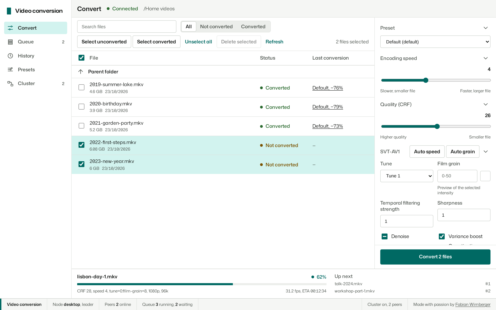
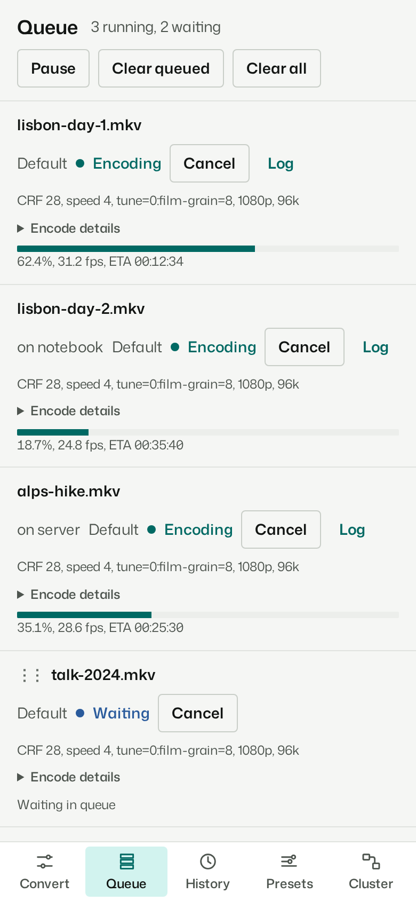

# Video Conversion Service

[](https://github.com/fabianwimberger/archive-video-av1/actions)
[](https://codecov.io/gh/fabianwimberger/archive-video-av1)
[](https://github.com/fabianwimberger/archive-video-av1/pkgs/container/archive-video-av1)
[](https://opensource.org/licenses/MIT)

A self-hosted, web-based video conversion service running in Docker. Converts video files to AV1 (via SVT-AV1) with real-time progress tracking, batch processing, and a browser UI.

## Background

AV1 saves 30-50% on file size versus H.264, but encoding is slow and most tools are CLI-only. This runs SVT-AV1 behind a browser UI so batch jobs can be queued, watched, and retried without shell access. Presets cover live-action, animated, and grainy sources.

| Desktop | Mobile |
|---------|--------|
|  |  |

## Features

- **Responsive web UI** with file browsing, queue controls, history filters, and real-time progress via WebSocket
- **AV1 encoding** using SVT-AV1 with FFmpeg (the pre-built image is a generic, portable build; source builds can enable PGO and `-march=native`)
- **Batch processing** with sequential job queue
- **Distributed processing** with opt-in LAN peer discovery and remote job delegation
- **Persistent** — conversion history, custom presets, and queue state survive restarts
- **Conversion presets:**
  - **Default** — CRF 26, general purpose
  - **Animated** — CRF 35 — optimized for animated content
  - **Grainy** — CRF 26, grain preservation (`film-grain=12:film-grain-denoise=1`)
  - **Very Grainy** — CRF 26, heavy grain preservation (`film-grain=18:film-grain-denoise=1`)
  - **Custom presets** — create, edit, duplicate, import/export your own presets
- **Automatic crop detection** (consensus-based, 8-point sampling)
- **Two-pass audio normalization** (loudnorm, Opus stereo output)
- **Configurable track selection** (default: German > English > first available)
- **Skips re-encoding** if source is already AV1
- **History view** with filtering, search, retry, and per-job settings inspection
- **Auto Speed / Auto Grain** — analyzes the selected file and suggests a preset or grain settings
- **Cleanup of originals** — delete a source once its conversion is recorded and the sizes still match

## Quick Start

```bash
git clone https://github.com/fabianwimberger/archive-video-av1.git
cd archive-video-av1
# set your library in docker-compose.yml: /path/to/your/videos:/videos
docker compose up -d
```

Open `http://localhost:8000`. The pre-built image runs on AMD64 and ARM64 and ships a generic FFmpeg build. Tags: `latest`, `main`, `vX.Y.Z`, `vX.Y`, `vX`, and the short commit SHA.

Without Compose:

```bash
docker run -d \
  --name convert-service \
  --restart unless-stopped \
  -p 8000:8000 \
  -v /path/to/your/videos:/videos \
  -v archive-video-av1-data:/app/data \
  ghcr.io/fabianwimberger/archive-video-av1:latest
```

### Build from source

`make build` compiles FFmpeg with PGO, LTO and `-march=native` for the host it runs on:

```bash
cp docker-compose.override.yml.example docker-compose.override.yml   # set your video path here
make build
make up
```

## How It Works

1. **File browser** shows `.mkv` and `.mp4` files from the mounted volume
2. **Select files** and choose conversion settings
3. **Jobs are queued** and processed sequentially in the background
4. **FFmpeg pipeline per file:**
   - Detect video codec (skip re-encode if AV1)
   - Crop detection via 8-point consensus sampling
   - Configurable audio and subtitle stream selection
   - SVT-AV1 video (+ subtitle) encoding and two-pass loudnorm audio
     normalization run as concurrent branches with live progress output
   - `mkvmerge` joins the two branches and finalizes metadata
5. **Real-time updates** are pushed to the browser via WebSocket
6. **Output** is saved alongside the source as Matroska (`_conv.mkv`), regardless of source container, with the source file's mode and owner

Outputs are published only after successful finalization and a duration check. Existing outputs are never overwritten; delete the previous conversion before encoding again. Files with the same stem, such as `movie.mp4` and `movie.mkv`, share an output name and cannot be queued together.

Deleting an original requires a completed conversion record whose source and output sizes still match the files. Keep that history until you finish removing originals. Unrecorded outputs and files changed since conversion require manual review outside the app.

## Presets

Presets are stored in the SQLite database and survive restarts.

- **Built-in presets** (`Default`, `Animated`, `Grainy`, `Very Grainy`) are seeded automatically and synced on startup. They cannot be edited or deleted, but you can duplicate them to create user presets.
- **User presets** can be created from the settings panel, or saved from any past job's settings snapshot.
- **Import / Export** — share presets as JSON documents via the Manage Presets modal.
- **Default preset** — one preset can be marked as default; it is pre-selected in the UI on load.

## Configuration

Settings are managed on the Settings page and stored in the SQLite database. An environment variable of the same name wins and locks the field read-only; otherwise the stored value is used, then the built-in default.

### Settings page

| Section | Settings | Takes effect |
|---------|----------|--------------|
| Tracks and languages | Audio and subtitle track mode, preferred language lists | Next job |
| Output files | Fallback file mode, file owner UID and GID | Next job |
| Cluster | Distributed mode, node name, public URL, leader URL, peers, node ID | After a restart |
| Maintenance | History retention in days and rows, log level | Log level immediately, retention on the next cleanup pass |

The node ID is taken from the hostname on first start, stored in the database and shown read-only, so a recreated container keeps it.

### Environment-only variables

| Variable | Default | Description |
|----------|---------|-------------|
| `SOURCE_MOUNT` | `/videos` | Mount point for source video files |
| `TEMP_DIR` | `/app/temp` | Temporary directory for in-progress conversions |
| `DATABASE_PATH` | `/app/data/app.db` | SQLite database path (persistent) |
| `TZ` | `UTC` | Container timezone |
| `DISTRIBUTED_NODE_ID` | stored | Overrides the stored node ID |
| `DISTRIBUTED_DISCOVERY_GROUP` / `DISTRIBUTED_DISCOVERY_PORT` | `239.255.42.99` / `9988` | Multicast peer discovery |
| `DISTRIBUTED_HEARTBEAT_SECONDS` / `DISTRIBUTED_PROGRESS_SECONDS` | `5` / `1` | Cluster coordination intervals |
| `DISTRIBUTED_PEER_TTL_SECONDS` / `DISTRIBUTED_WORKER_TIMEOUT_SECONDS` | `20` / `120` | Peer expiry and worker timeout |
| `DISTRIBUTED_MAX_REQUEUES` | `3` | Requeue attempts before a job fails |
| `DISTRIBUTED_STATE_DIR` | `<SOURCE_MOUNT>/.archive-video-av1` | Shared cluster queue ledger directory |
| `CORS_ORIGINS` | `http://localhost:3000,http://127.0.0.1:3000` | Allowed browser origins |

The remaining `DISTRIBUTED_*` variables are described in [docs/distributed.md](docs/distributed.md).

## Distributed Processing

Several nodes on a trusted LAN can share one queue: set `DISTRIBUTED_ENABLED=true` on each and mount the same library at the same path. An elected leader hands pending jobs to idle peers and requeues the work of a node that disappears. Requirements, node setup, failure handling and the other `DISTRIBUTED_*` variables are in [docs/distributed.md](docs/distributed.md).

## Security

No built-in authentication — intended for trusted networks or behind a reverse proxy with auth. Bind to `127.0.0.1:8000:8000` to restrict access to localhost.

## License

MIT License — see [LICENSE](LICENSE) file.

### Third-Party Licenses

This software includes the following open-source components:

| Component | License | Source |
|-----------|---------|--------|
| FFmpeg | [GPL v2+](https://www.gnu.org/licenses/old-licenses/gpl-2.0.html) | https://git.ffmpeg.org/ffmpeg.git |
| SVT-AV1 | [BSD-3-Clause-Clear](https://gitlab.com/AOMediaCodec/SVT-AV1/-/blob/master/LICENSE.md) | https://gitlab.com/AOMediaCodec/SVT-AV1 |
| Opus | [BSD-3-Clause](https://opus-codec.org/license/) | https://opus-codec.org/ |

When using the pre-built Docker image, FFmpeg is compiled with GPL enabled. The FFmpeg license notice is included in the image at `/usr/share/licenses/FFmpeg-LICENSE`.
